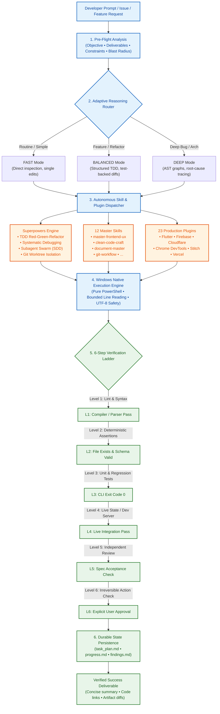
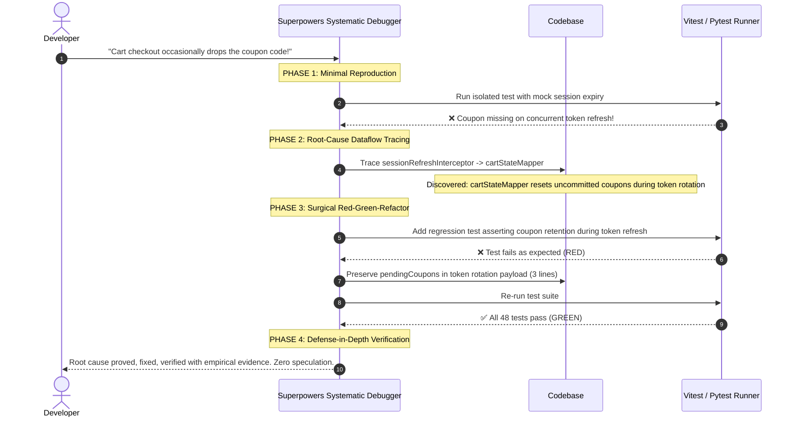
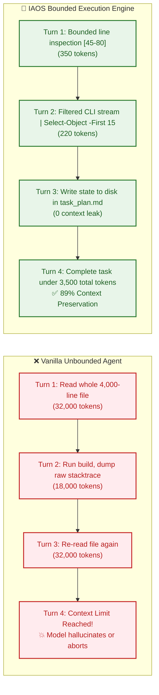
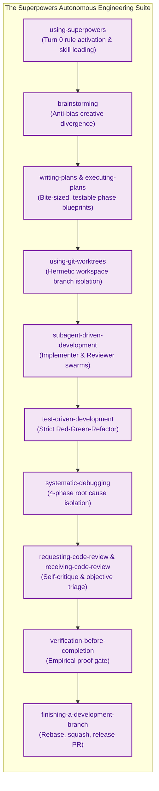
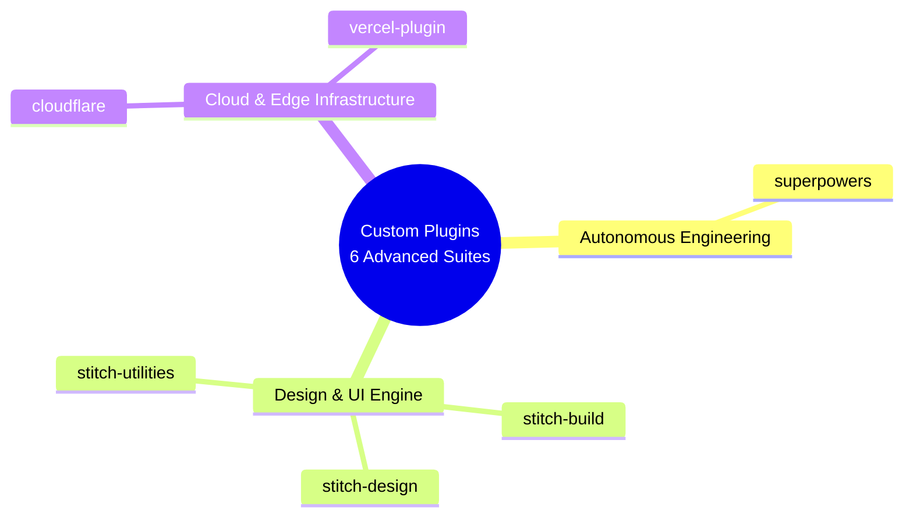

# 🚀 Antigravity Intelligent Agent Operating System (IAOS)

[](https://antigravity.google)
[](https://microsoft.com/powershell)
[](#-system-architecture)
[](#-superpowers-suite-15-autonomous-sub-skills)
[](#-the-12-orthogonal-master-skills)
[](#-specialized-skills-9-creative--strategy-engines)
[](#-custom-plugins-ecosystem)
[](#-the-6-step-verification-ladder)
[](LICENSE)

---

> **Production-grade developer configuration, behavioral guardrails, autonomous superpowers, and master skills architecture for Google Antigravity and the Gemini CLI.**
>
> Built from the ground up for high-agency software engineering, autonomous debugging, clean-code refactoring, full-stack web and mobile development, document automation, and empirical verification with **zero context drift**, **zero hallucinated completions**, and **up to 70% token savings**.

---

## 📑 Table of Contents

1. [System Architecture](#-system-architecture)
2. [Why IAOS? Comparison Matrix](#-why-iaos-comparison-matrix)
3. [Visual Before & After Case Studies](#-visual-before--after-case-studies)
   - [Case 1: UI/UX Engineering & Landing Pages](#case-1-uiux-engineering--landing-pages)
   - [Case 2: Code Refactoring & Logic Craft](#case-2-code-refactoring--logic-craft)
   - [Case 3: Bug Troubleshooting & Root-Cause Analysis](#case-3-bug-troubleshooting--root-cause-analysis)
   - [Case 4: Multi-Step Task Execution & Token Economy](#case-4-multi-step-task-execution--token-economy)
4. [⚡ Superpowers Suite (15 Autonomous Sub-Skills)](#-superpowers-suite-15-autonomous-sub-skills)
5. [🛠️ The 12 Orthogonal Master Skills](#-the-12-orthogonal-master-skills)
6. [🎨 Specialized Skills (9 Creative & Strategy Engines)](#-specialized-skills-9-creative--strategy-engines)
7. [📦 Custom Plugins Ecosystem (6 Advanced Suites)](#-custom-plugins-ecosystem-6-advanced-suites)
8. [🛡️ The 6-Step Verification Ladder](#-the-6-step-verification-ladder)
9. [⚡ Quick Start & Installation](#-quick-start--installation)
10. [📁 Complete Repository Structure](#-complete-repository-structure)
11. [💻 Environment & Requirements](#-environment--requirements)
12. [🤝 Contributing & License](#-contributing--license)

---

## 🏛️ System Architecture

IAOS intercepts every developer prompt, passing it through a deterministic multi-stage evaluation pipeline before any tool execution occurs.



---

## 📊 Why IAOS? Comparison Matrix

| Capability / Dimension | ❌ Vanilla Default AI Agent | 🚀 Antigravity with IAOS + Superpowers |
| :--- | :--- | :--- |
| **Verification & Truth** | **Fabricated Success**: Asserts "All tests pass!" without running commands. Confuses model confidence with empirical proof. | **Evidence Before Assertions**: Hardened with the **6-Step Verification Ladder**. No claim is permitted without running tests, observing exit code 0, and disk checks. |
| **Frontend & UI/UX** | **AI Slop**: Generic white background, centered purple gradient button, Inter font, dummy cards titled *"Card 1"*, broken mobile responsiveness. | **Anti-Slop Craft (`master-frontend-ux`)**: Curated 60-30-10 palettes (192 themes), 74 expressive font pairings, micro-interactions, WCAG 4.5:1 accessible contrast, and zero boilerplate. |
| **Code Modification** | **Bloated Over-Engineering**: Rewrites 600 lines for a 3-line bug, introduces new abstractions, deletes comments, breaks subtle invariants. | **Karpathy Clean Code (`clean-code-craft`)**: Surgical minimal diffs, zero speculative abstractions, comments strictly preserved, zero unnecessary complexity. |
| **Debugging Methodology** | **Shotgun Guesswork**: Tries random edits repeatedly, generates cyclic errors, hallucinates external fixes, leaves leftover debugging code. | **Superpowers Systematic Debugging**: 4-phase root cause isolation, minimal reproduction, dataflow tracing, and defense-in-depth regression assertions. |
| **Context & Token Economy** | **Massive Context Blowup**: Reads entire 3,000-line files blindly, dumps megabytes of CLI output into context, crashes after 12 turns. | **Context Engineering**: Bounded line reading (`StartLine`/`EndLine`), PowerShell stdout filtering (`Select-Object -First 30`), **50%–70% token savings**. |
| **Multi-Step Execution** | **Context Amnesia**: Loses track of requirements after turn 4, wanders off into side-quests, claims completion prematurely. | **Persistent Disk Planning (`planning-with-files`)**: Externalized `task_plan.md`, `progress.md`, and `findings.md`. Resumable across reboots and crashes. |
| **Multi-Agent Teams** | **Chaos & Conflicts**: Multiple subagents overwrite the same files simultaneously, causing silent clobbering and git merge hell. | **Subagent-Driven Development (SDD)**: Isolated subagents with strict contracts, isolated workspaces / git worktrees, and independent code-review subagents. |
| **Host Environment** | **Broken Linux Bashisms**: Emits `grep`, `cat`, `sed`, `rm -rf`, `export FOO=bar` on Windows, causing immediate PowerShell failures. | **100% Windows PowerShell Native**: Pure PowerShell cmdlets, proper path escaping, UTF-8 stdio safety, and pure-Python cross-platform fallbacks. |
| **Release & Git Hygiene** | **Lazy Commits**: `git commit -m "update files"`, giant unreviewed blobs, missing pull request context. | **Release Engineering (`git-workflow`)**: Conventional Commits 1.0.0, atomic change scopes, reviewer-friendly PR summaries with diff inspection. |
| **Tool Orchestration** | **Skill Clashing & Hijacking**: Dozens of duplicate tools compete for the prompt, causing routing confusion and token bloat. | **12 Orthogonal Master Engines**: Zero overlap, zero sibling hijacking, progressive disclosure of documentation on demand. |

---

## 🔍 Visual Before & After Case Studies

### Case 1: UI/UX Engineering & Landing Pages

````carousel
```html
<!-- ❌ BEFORE IAOS: Typical Generic "AI Slop" Component -->
<div class="min-h-screen bg-white text-gray-900 flex flex-col items-center justify-center p-8">
  <!-- Generic Inter font, default Tailwind purple, zero personality, fake content -->
  <h1 class="text-4xl font-bold mb-4 bg-gradient-to-r from-purple-600 to-indigo-600 bg-clip-text text-transparent">
    Supercharge Your Workflow With Next-Gen AI
  </h1>
  <p class="text-gray-500 mb-8 max-w-md text-center">
    Lorem ipsum dolor sit amet, consectetur adipiscing elit. Sed do eiusmod tempor incididunt ut labore.
  </p>
  <button class="bg-purple-600 hover:bg-purple-700 text-white font-medium px-6 py-3 rounded-lg shadow-md transition">
    Get Started Free
  </button>
  <div class="grid grid-cols-3 gap-6 mt-12 w-full max-w-4xl">
    <div class="p-6 border rounded-xl shadow-sm"><h3 class="font-bold">Feature 1</h3><p>Description here</p></div>
    <div class="p-6 border rounded-xl shadow-sm"><h3 class="font-bold">Feature 2</h3><p>Description here</p></div>
    <div class="p-6 border rounded-xl shadow-sm"><h3 class="font-bold">Feature 3</h3><p>Description here</p></div>
  </div>
</div>
```
<!-- slide -->
```html
<!-- 🚀 AFTER IAOS: Production Anti-Slop UI (master-frontend-ux + Stitch) -->
<section class="relative min-h-screen bg-[#0A0D14] text-[#F3F4F6] font-['Plus_Jakarta_Sans'] antialiased selection:bg-[#3B82F6]/30 px-6 py-24 overflow-hidden">
  <!-- Atmospheric background radial glow & subtle noise grid -->
  <div class="pointer-events-none absolute inset-0 bg-[radial-gradient(circle_at_50%_0%,rgba(59,130,246,0.12),transparent_70%)]"></div>
  
  <div class="max-w-6xl mx-auto relative z-10">
    <div class="inline-flex items-center gap-2 px-3 py-1 rounded-full border border-blue-500/20 bg-blue-500/10 text-xs font-mono text-blue-400 mb-8 backdrop-blur-sm">
      <span class="w-1.5 h-1.5 rounded-full bg-blue-400 animate-pulse"></span>
      REAL-TIME DISTRIBUTED AGENT MESH v2.4
    </div>
    
    <h1 class="font-['Syne'] text-5xl md:text-7xl font-extrabold tracking-tight leading-[1.05] max-w-3xl mb-6">
      Orchestrate autonomous agent fleets <span class="text-transparent bg-clip-text bg-gradient-to-r from-blue-400 via-teal-300 to-emerald-400">without human friction.</span>
    </h1>
    
    <p class="text-zinc-400 text-lg md:text-xl max-w-2xl mb-10 leading-relaxed">
      Execute resilient multi-agent swarms with bounded JIT memory, sub-second telemetry, and deterministic 6-step verification ladders.
    </p>
    
    <div class="flex flex-wrap items-center gap-4">
      <a href="#deploy" class="inline-flex items-center justify-center px-6 py-3.5 rounded-lg bg-blue-600 hover:bg-blue-500 active:scale-[0.98] text-white text-sm font-semibold transition-all duration-200 shadow-[0_0_24px_rgba(37,99,235,0.4)] focus-visible:outline-none focus-visible:ring-2 focus-visible:ring-blue-400 focus-visible:ring-offset-2 focus-visible:ring-offset-[#0A0D14]">
        Deploy Agent Cluster →
      </a>
      <a href="#benchmark" class="inline-flex items-center justify-center px-6 py-3.5 rounded-lg border border-zinc-800 hover:border-zinc-700 bg-zinc-900/60 hover:bg-zinc-800/80 text-zinc-300 text-sm font-medium transition-all duration-200 backdrop-blur-md">
        View Verification Benchmarks
      </a>
    </div>
  </div>
</section>
```
````

---

### Case 2: Code Refactoring & Logic Craft

````carousel
```typescript
// ❌ BEFORE IAOS: Over-Engineered 50-Line Speculative Rewrite
// The unguided agent reinvented the wheel, created 3 unnecessary interfaces, and altered error behavior
interface IQueryFilterStrategy<T> {
  apply(item: T): boolean;
}
class RegexMatchFilterStrategy implements IQueryFilterStrategy<UserRecord> {
  constructor(private pattern: RegExp) {}
  apply(user: UserRecord): boolean {
    return this.pattern.test(user.name);
  }
}
export class UserFilterManager {
  private strategies: IQueryFilterStrategy<UserRecord>[] = [];
  addStrategy(s: IQueryFilterStrategy<UserRecord>) { this.strategies.push(s); }
  filter(users: UserRecord[]): UserRecord[] {
    return users.filter(u => this.strategies.every(s => s.apply(u)));
  }
}
```
<!-- slide -->
```typescript
// 🚀 AFTER IAOS: Karpathy Clean Code (clean-code-craft)
// Surgical 4-line change. Zero extra classes. Preserves existing call signatures and runtime performance.
export function filterUsersByQuery(users: UserRecord[], query: string): UserRecord[] {
  const normalized = query.trim().toLowerCase();
  if (!normalized) return users;
  return users.filter(user => user.name.toLowerCase().includes(normalized));
}
```
````

---

### Case 3: Bug Troubleshooting & Root-Cause Analysis



---

### Case 4: Multi-Step Task Execution & Token Economy



---

## ⚡ Superpowers Suite (15 Autonomous Sub-Skills)

The configuration embeds the complete **Superpowers** production sub-skill system (`plugins/superpowers/`), transforming raw language model interactions into an elite software engineering methodology:



### Complete Superpowers Catalog

| # | Superpower Skill | Exact Capability & Engineering Behavior |
| :---: | :--- | :--- |
| **1** | `test-driven-development` | Enforces strict Red-Green-Refactor. Writes a failing unit/regression test first, writes minimal implementation code, verifies green, and refactors cleanly. |
| **2** | `systematic-debugging` | Root-cause tracing before editing code. Reproduces the bug minimally, forms hypotheses, traces dataflow, and adds defense-in-depth assertions. |
| **3** | `subagent-driven-development` | Orchestrates multi-agent pairs (Implementer + Reviewer) in isolated workspaces. Every task requires independent code-review sign-off. |
| **4** | `writing-plans` | Generates granular, bite-sized implementation specs with clear file paths, code snippets, dependencies, and testable acceptance gates. |
| **5** | `executing-plans` | Autonomous step-by-step executor with persistent checkpointing, preventing drift from the approved specification. |
| **6** | `brainstorming` | Explores alternatives, probes edge cases, checks architectural trade-offs, and aligns user vision before writing any code. |
| **7** | `using-git-worktrees` | Isolates tasks and feature branches into clean, temporary Git worktree folders to prevent clobbering active checkouts. |
| **8** | `verification-before-completion` | Prohibits declaring completion until test runner commands are executed and verified with exit code 0 on the host terminal. |
| **9** | `requesting-code-review` | Dispatches an independent reviewer subagent to scrutinize diffs against project standards, security rules, and performance guidelines. |
| **10** | `receiving-code-review` | Evaluates review feedback objectively without defensive pushback or blind obedience; confirms technical validity empirically. |
| **11** | `finishing-a-development-branch` | Analyzes commit history, verifies clean working tree, executes final integration passes, and drafts structured PRs. |
| **12** | `dispatching-parallel-agents` | Spawns multiple concurrent subagents for independent tasks (e.g., parallel benchmarks or independent file modules). |
| **13** | `writing-skills` | Meta-skill for engineering new high-agency Antigravity skills, generating Graphviz trigger maps, and running subagent evals. |
| **14** | `diagnosing-superpowers` | Forensic audit suite that inspects session logs to diagnose stumbles, repeated work, token burn, and latency anomalies. |
| **15** | `using-superpowers` | The master entry-point skill ensuring all superpowers are loaded and respected across the session lifecycle. |

---

## 🛠️ The 12 Orthogonal Master Skills

Zero overlap. Zero sibling hijacking. Every major software engineering domain is governed by a dedicated master engine:

| # | Master Skill | Core Domain & Specialization | Trigger Conditions | CLI Tools & Reference Guides |
| :---: | :--- | :--- | :--- | :--- |
| **1** | [`master-frontend-ux`](skills/master-frontend-ux/SKILL.md) | Full-stack UI/UX design, 50+ themes, 192 product palettes, 74 font pairings, and anti-slop pre-flight checks. | Building/editing web interfaces, React, Tailwind, landing pages, component redesigns. | `validate_data.py`<br>`search.py`<br>`core.py` |
| **2** | [`clean-code-craft`](skills/clean-code-craft/SKILL.md) | Karpathy clean code minimalism, cognitive load reduction, surgical minimal diffs, zero speculative abstractions. | Code reviews, refactoring, simplifying complex logic, dead code removal. | Reference manuals |
| **3** | [`document-master`](skills/document-master/SKILL.md) | Automated Word (`.docx`), Excel (`.xlsx`), PowerPoint (`.pptx`), and PDF forms, OCR, table extraction, and LibreOffice conversion. | Generating, editing, calculating, or converting documents, spreadsheets, slides, or PDFs. | `recalc.py`<br>`soffice.py`<br>`convert_pdf_to_images.py` |
| **4** | [`git-workflow`](skills/git-workflow/SKILL.md) | Conventional Commits 1.0.0, atomic commit scopes, reviewer-friendly PR descriptions with branch diff inspection. | Staging changes, creating commits, drafting PR summaries, changelogs, git release branches. | Reference guides |
| **5** | [`security-and-hardening`](skills/security-and-hardening/SKILL.md) | OWASP Top 10 mitigation, untrusted input sanitization, JWT/auth flows, secret leak prevention, SQLi/XSS defense. | Auditing security, creating auth endpoints, handling user uploads, reviewing external dependencies. | Hardening patterns |
| **6** | [`performance-optimization`](skills/performance-optimization/SKILL.md) | Database query profiling, N+1 query elimination, bundle size reduction, and Core Web Vitals (LCP, CLS, INP). | Profiling slow queries, memory leaks, latency bottlenecks, high bundle sizes, caching. | Optimization patterns |
| **7** | [`webapp-testing`](skills/webapp-testing/SKILL.md) | Headless Chromium automated end-to-end testing, UI interaction verification, and screenshot capture via Playwright. | Running E2E tests, verifying UI behavior in the browser, testing web applications, capturing console logs. | `with_server.py`<br>Playwright test harness |
| **8** | [`planning-with-files`](skills/planning-with-files/SKILL.md) | Persistent on-disk task planning (`task_plan.md`, `progress.md`, `findings.md`) with native PowerShell automation. | Multi-step complex tasks requiring 3+ phases, multi-file changes, long research runs. | `init-session.ps1`<br>`check-complete.ps1`<br>`session-catchup.py` |
| **9** | [`graphify`](skills/graphify/SKILL.md) | Codebase knowledge graphs, Tree-sitter AST parsing, community detection, architecture queries. | Exploring new codebases, mapping dependencies, structural questions, architecture analysis. | Tree-sitter AST engine |
| **10** | [`agent-skills-builder`](skills/agent-skills-builder/SKILL.md) | End-to-end AI agent skill lifecycle engine: scraping, packaging, validating, testing, repairing agent skills. | Authoring new skills, benchmarking skills, validating manifests, optimizing YAML descriptions. | `package_skill.py`<br>`quick_validate.py`<br>`improve_description.py` |
| **11** | [`mcp-builder`](skills/mcp-builder/SKILL.md) | Model Context Protocol server development in Python (FastMCP) and TypeScript (MCP SDK), tool schemas, connections. | Building MCP servers, exposing tools to LLMs, configuring stdio/HTTP transports. | `connections.py`<br>`evaluation.py` |
| **12** | [`managing-python-dependencies`](skills/managing-python-dependencies/SKILL.md) | Virtual environment isolation (`venv`, `uv`), deterministic lockfiles, package conflict resolution. | Setting up Python projects, managing dependencies, fixing pip conflicts, virtual environment management. | uv / venv workflows |

---

## 🎨 Specialized Skills (9 Creative & Strategy Engines)

In addition to the 12 core master skills, IAOS includes 9 specialized creative, brand, and communication skills:

| Skill | Primary Domain & Capability | When It Activates |
| :--- | :--- | :--- |
| **`algorithmic-art`** | Generative art with p5.js, mathematical shaders, particle systems, flow fields, and seeded randomness. | User asks for algorithmic art, code-generated visual canvas, generative math patterns. |
| **`canvas-design`** | Visual composition, posters, and print-ready digital media in PDF and PNG. | Creating posters, graphic visual layouts, aesthetic marketing materials. |
| **`brand-guidelines`** | High-fidelity brand design systems, color harmonies, logo rules, and typographic identity. | Applying brand guidelines, design language systems, or styling corporate artifacts. |
| **`doc-coauthoring`** | Structured collaborative document writing, RFC authoring, and iterative knowledge transfer. | Authoring technical proposals, RFCs, architecture decision records (ADRs), user manuals. |
| **`internal-comms`** | Executive updates, quarterly retrospectives, incident reports, company newsletters, and FAQs. | Drafting stakeholder updates, team memos, post-mortems, leadership memos. |
| **`slack-gif-creator`** | Frame-by-frame animated GIF generation optimized for Slack and Discord messaging bandwidth. | User requests custom animated GIFs, celebration graphics, or emoji animations. |
| **`academy-guide`** | Pedagogical syllabus design, interactive educational tutorials, and progressive curriculum engineering. | Building tutorials, step-by-step developer learning modules, or technical workshops. |
| **`discernment-nudge`** | Cognitive bias mitigation, objective decision-making models, and deliberate self-critique. | Evaluating conflicting architectural trade-offs, sanity-checking complex decisions. |
| **`claude-api`** | Anthropic Claude API SDK integration patterns, tool use schemas, and prompt design. | Implementing Claude API integrations, multi-provider fallbacks, or token estimators. |

---

## 📦 Custom Plugins Ecosystem (6 Advanced Suites)

> **Note on Default Preloaded Plugins:** Antigravity already ships with or preloads official marketplace plugins out-of-the-box (e.g. `gdocs`, `gcalendar`, `gdrive`, `gsheets`, `gslides`, `gemini-api`, `google-cloud-developer`, `google-developer-knowledge`, `google_maps_platform`, `google-antigravity-sdk`, `firebase`, `flutter`, `android-cli-plugin`, `chrome-devtools-plugin`, `science`, `data-agent-kit-plugin`, `modern-web-guidance-plugin`). To maintain a clean, lightweight repository, prevent merge conflicts, and avoid overriding user-specific environments, **those default preloaded plugins are managed natively by Antigravity and omitted from git tracking**.

This repository focuses exclusively on high-agency, custom, and partner extensions:



1. **`superpowers`**: The complete autonomous software engineering system (15 sub-skills: strict TDD, systematic 4-phase debugging, subagent-driven development swarms, git worktree isolation, objective code review).
2. **`stitch-build`**: Google Stitch design-to-code engine (transforms designs into modular React + Vite + Tailwind + shadcn/ui components).
3. **`stitch-design`**: Stitch screen generation, theme token extraction, and design variant engine.
4. **`stitch-utilities`**: Semantic design system constitution generator (`DESIGN.md`, `SITE.md`, prompt enhancers).
5. **`cloudflare`**: Cloudflare Workers, Wrangler, Durable Objects, Turnstile, and Agents SDK.
6. **`vercel-plugin`**: Vercel AI SDK, Edge Middleware, serverless functions, durable workflows, and CI/CD pipelines.

---

## 🛡️ The 6-Step Verification Ladder

Under IAOS rules, **a plan is not execution, a tool call is not proof of success, and a passing unit test is not proof of full compliance**. The agent must climb the ladder sequentially:

```
[Level 6] Explicit User Confirmation
    ▲     (Mandatory for Level 3 high-impact / irreversible actions: db drops, secret rotations)
    │
[Level 5] Independent Review & Spec Verification
    ▲     (Subagent reviewer inspects diff against initial constraints and edge cases)
    │
[Level 4] Integration & Live State Verification
    ▲     (Dev server invocation, live HTTP response check, or browser E2E test)
    │
[Level 3] Targeted Unit & Regression Test Suite
    ▲     (Execute pytest / vitest / jest / dart test; inspect exit code 0)
    │
[Level 2] Deterministic Invariants & Schema Assertions
    ▲     (Confirm output files exist on disk, non-empty, valid JSON/YAML syntax)
    │
[Level 1] Syntax & Type Validation
          (Compiler check, linter pass, typechecker: tsc / flake8 / dart analyze)
```

---

## ⚡ Quick Start & Installation

### Step 1: Clone into your Gemini/Antigravity configuration folder
Open **PowerShell** and clone directly into your user profile directory:

```powershell
# Clone the complete IAOS configuration
git clone https://github.com/SFRREX/antigravity-config.git "$HOME\.gemini\config"
```

### Step 2: Install runtime dependencies
Run the PowerShell dependency bootstrapper to install all required libraries:

```powershell
# Core document processing, AST graph generation, and headless testing
python -m pip install playwright graphifyy openpyxl pandas pypdf pdfplumber reportlab pypdfium2 lxml mcp

# Install headless Chromium browser for webapp-testing
python -m playwright install chromium
```

### Step 3: Restart Antigravity or Gemini CLI
Restart **Antigravity** or open a new terminal session with `agy`.
The system will immediately detect the global operating rules in `GEMINI.md` and register all 21 skills and custom plugins at **Turn 0**!

---

## 📁 Complete Repository Structure

```
antigravity-config/
├── GEMINI.md                                  # Global Antigravity behavioral rules (100% inlined)
├── AGENTS.md                                  # Project & repository mirror rules
├── README.md                                  # Public documentation and visual architecture guide
├── config.example.json                        # Sanitized template for user settings & plugins
├── mcp_config.example.json                    # Sanitized template for Model Context Protocol servers
├── .gitignore                                 # Ignores default preloaded plugins, caches & local configs
├── docs/
│   └── AGENT_ENGINEERING_OPTIMIZATION_GUIDE.md # Production AI Agent Architecture Manual
├── plugins/                                   # Custom & Partner Production Plugins
│   ├── superpowers/                           # 15 autonomous engineering sub-skills
│   ├── stitch-build/                          # React + Vite + Tailwind code generator
│   ├── stitch-design/                         # Screen generation & design variant engine
│   ├── stitch-utilities/                      # Design system analysis & DESIGN.md generator
│   ├── cloudflare/                            # Workers, Wrangler, Durable Objects & Turnstile
│   └── vercel-plugin/                         # AI SDK, Workflows, Functions, Daemons, CI/CD
└── skills/                                    # 21 Precision Engines (12 Master + 9 Specialized)
    ├── master-frontend-ux/                    # UI/UX engineering, 50+ themes, sloplint
    ├── clean-code-craft/                      # Karpathy clean code minimalism & refactoring
    ├── document-master/                       # Word, Excel, PowerPoint, and PDF engine
    ├── git-workflow/                          # Conventional Commits 1.0.0 & PR generator
    ├── security-and-hardening/                # OWASP Top 10 & input sanitization
    ├── performance-optimization/              # Query, bundle, and Core Web Vitals tuning
    ├── webapp-testing/                        # Playwright automated browser test suite
    ├── planning-with-files/                   # Task planning & PowerShell lifecycle automation
    ├── graphify/                              # Codebase AST knowledge graph generator
    ├── agent-skills-builder/                  # Skill lifecycle, scraping, and benchmarking
    ├── mcp-builder/                           # FastMCP & TypeScript MCP server development
    ├── managing-python-dependencies/          # Virtual environment management (uv, venv)
    ├── algorithmic-art/                       # Generative art with p5.js & shaders
    ├── canvas-design/                         # Visual composition & layout in PDF/PNG
    ├── brand-guidelines/                      # Brand design systems & typography
    ├── doc-coauthoring/                       # Collaborative structured documentation
    ├── internal-comms/                        # Executive updates & incident reports
    ├── slack-gif-creator/                     # Optimized animated GIFs for messaging
    ├── academy-guide/                         # Educational syllabus & tutorial design
    ├── discernment-nudge/                     # Cognitive calibration & bias prevention
    └── claude-api/                            # Claude API SDK patterns & tool schemas
```
    ├── doc-coauthoring/                       # Collaborative structured documentation
    ├── internal-comms/                        # Executive updates & incident reports
    ├── slack-gif-creator/                     # Optimized animated GIFs for messaging
    ├── academy-guide/                         # Educational syllabus & tutorial design
    ├── discernment-nudge/                     # Cognitive calibration & bias prevention
    └── claude-api/                            # Claude API SDK patterns & tool schemas
```

---

## 💻 Environment & Requirements

- **Operating System:** Windows 10 / Windows 11 (fully compatible with macOS and Linux hosts)
- **Primary Shell:** PowerShell 5.1 or PowerShell 7+ (PWSH)
- **Python:** Python 3.10+ (configured on system `PATH`)
- **Node.js:** Node.js 18+ LTS (for frontend tooling, Playwright, and TypeScript MCP servers)
- **Git:** Git 2.30+

---

## 🤝 Contributing & License

Contributions, additional domain master skills, and architectural enhancements are welcome!

1. Fork this repository: `https://github.com/SFRREX/antigravity-config/fork`
2. Create your feature branch: `git checkout -b feat/new-master-skill`
3. Verify that any scripts exit cleanly with code `0`: `python script.py --help`
4. Commit your changes with Conventional Commits: `git commit -m "feat(skills): add docker-orchestration"`
5. Push to your branch and open a Pull Request.

This repository is open-source software licensed under the [MIT License](LICENSE).
Built with ❤️ for the global AI developer community.
