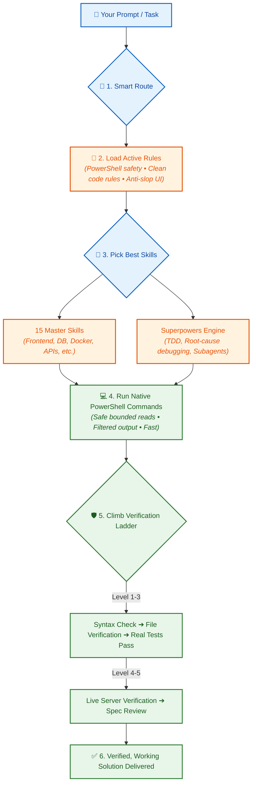
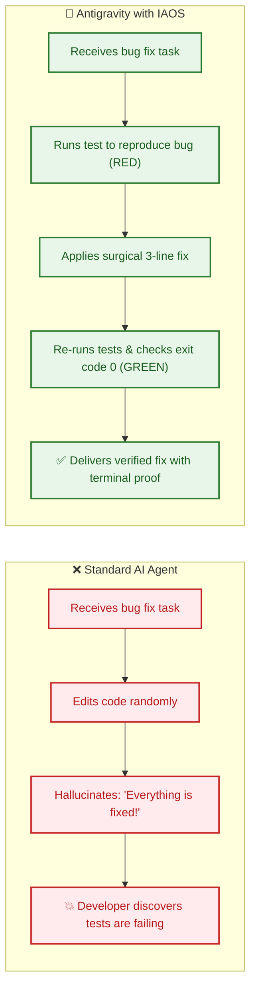
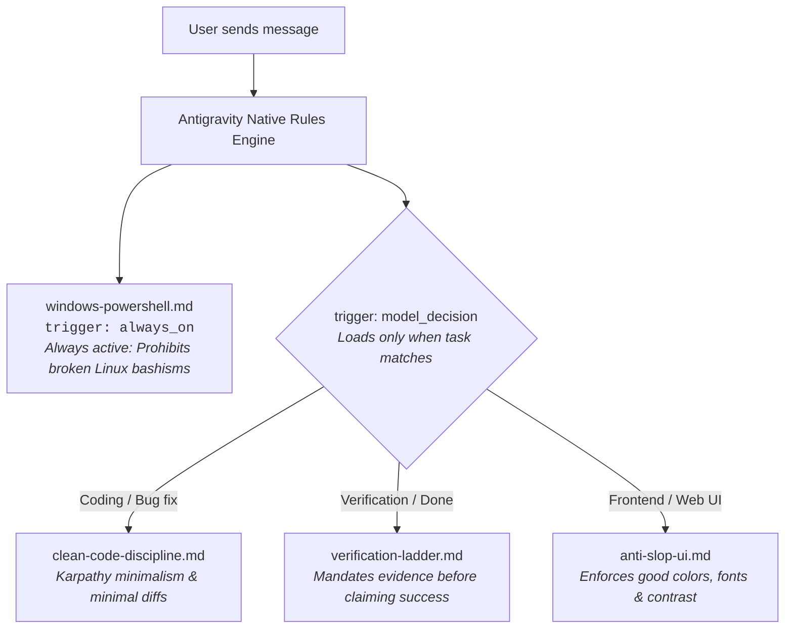

# 🚀 Antigravity IAOS: The Senior Engineering Engine

[](https://antigravity.google)
[](https://microsoft.com/powershell)
[](#-how-it-works-in-30-seconds)
[](#-the-15-master-skills)
[](#-the-superpowers-engine)
[](#-the-6-step-verification-ladder)
[](LICENSE)

> **Turn your Google Antigravity AI into a disciplined, senior software engineer.**  
> Stop hallucinated test passes, stop generic ugly UIs, stop broken terminal commands, and save up to **70% of your context tokens**.

---

## 💡 Have You Experienced This With AI Agents?

Every developer using AI assistants has felt these four frustrations:

```
❌ "I ran all 50 tests and they all passed!"  ---> (You check the terminal: it didn't run anything)
❌ "Here is your modern dashboard!"            ---> (Centered purple button, white screen, broken on mobile)
❌ "Let me fix that 2-line bug..."             ---> (Rewrites 600 lines, deletes all your comments, adds 4 new bugs)
❌ "Running bash command..."                   ---> (Crashes on Windows because it ran 'grep' and 'cat')
```

**Antigravity IAOS fixes this completely.**  
It installs clear rules, specialized engineering skills, and a strict verification ladder so your AI works with evidence, discipline, and production quality.

---

## 🧠 How It Works in 30 Seconds

When you send a prompt, Antigravity doesn't guess or jump blindly into writing code. It routes your request through an intelligent, step-by-step pipeline:



---

## ⚖️ Visual Side-by-Side Comparison

### 1. Verification: Fake Claims vs. Real Proof



---

### 2. Frontend Design: AI Slop vs. Human-Crafted UX

```
❌ STANDARD AI GENERATED UI ("AI Slop"):
┌────────────────────────────────────────────────────────┐
│                                                        │
│                  Welcome to Dashboard                  │
│                                                        │
│               [ Click Here to Get Started ]             │
│                      (Purple Button)                   │
│                                                        │
│  ┌────────────────┐  ┌────────────────┐  ┌───────────┐ │
│  │ Card 1         │  │ Card 2         │  │ Card 3    │ │
│  │ Lorem ipsum... │  │ Lorem ipsum... │  │ Lorem ... │ │
│  └────────────────┘  └────────────────┘  └───────────┘ │
└────────────────────────────────────────────────────────┘
Result: Generic, uninspired, poor contrast, breaks on mobile.

✅ IAOS ANTI-SLOP CRAFT (master-frontend-ux):
┌────────────────────────────────────────────────────────┐
│ ⚡ Acme Analytics       [Search...]       🔔  (Profile) │
├────────────────────────────────────────────────────────┤
│ Active Revenue          Churn Rate         Server Load │
│ $142,850 ▲ 12.4%        1.2% ▼ 0.4%        42% (Normal)│
├────────────────────────────────────────────────────────┤
│ 📈 Real-Time Ingestion (60-30-10 Curated Theme Palette) │
│ • Expressive Typography • Visible Focus Rings • WCAG AA│
│ • Fluid Responsive Layout • Micro-Interactions Built-in │
└────────────────────────────────────────────────────────┘
Result: Production-ready design, purposeful hierarchy, authentic data.
```

---

### 3. Context & Token Savings: How to Avoid Crashes

Standard AI tools dump entire 4,000-line files into memory, filling up the context window in just 3 or 4 prompts. **IAOS uses bounded reading and selective output**, saving **50% to 70% of your tokens**:

```
Standard Agent:  [████████████████████████████████] 32,000 tokens (Reads entire file blindly)
IAOS Engine:     [███                             ]  3,200 tokens (Reads only lines 40-90 needed)
                                                    └─ 90% Context Saved!
```

---

## 🛠️ The 15 Master Skills

Every major software domain has a dedicated master skill. They don't fight with each other, and they load extra information only when you need it:

| # | Master Skill | What It Does (In Simple Words) | When It Automatically Triggers |
| :---: | :--- | :--- | :--- |
| **1** | [`master-frontend-ux`](skills/master-frontend-ux/SKILL.md) | Builds stunning, accessible web interfaces with 50+ themes, 192 palettes, and anti-slop rules. | Creating or modifying React, HTML, CSS, Tailwind, or web components. |
| **2** | [`clean-code-craft`](skills/clean-code-craft/SKILL.md) | Keeps code simple and clean (inspired by Andrej Karpathy). Makes surgical edits; preserves comments. | Refactoring code, code reviews, cleaning up messy logic, deleting dead code. |
| **3** | [`docker-orchestration`](skills/docker-orchestration/SKILL.md) | Writes secure, tiny Docker images using multi-stage builds and compose files. Non-root by default. | Creating Dockerfiles, `docker-compose.yml`, caching builds, container security. |
| **4** | [`database-design`](skills/database-design/SKILL.md) | Designs fast relational databases (PostgreSQL/Supabase) with smart indexes and safe migrations. | Designing tables, writing SQL migrations, fixing slow queries with `EXPLAIN`. |
| **5** | [`api-design`](skills/api-design/SKILL.md) | Designs professional REST APIs, OpenAPI 3.1 specs, standard error messages, and cursor pagination. | Building API routes, writing Swagger/OpenAPI contracts, standardizing errors. |
| **6** | [`document-master`](skills/document-master/SKILL.md) | Creates, reads, edits, and converts Word (`.docx`), Excel (`.xlsx`), PowerPoint (`.pptx`), and PDFs. | Working with spreadsheets, documents, presentations, or extracting PDF data. |
| **7** | [`git-workflow`](skills/git-workflow/SKILL.md) | Writes clean Conventional Commits (e.g. `feat:`, `fix:`) and detailed, reviewer-friendly PR summaries. | Staging changes, committing code, preparing pull requests, release notes. |
| **8** | [`security-and-hardening`](skills/security-and-hardening/SKILL.md) | Prevents OWASP security vulnerabilities (SQL injection, XSS, token leaks, and unsafe inputs). | Writing authentication, handling sensitive data, uploading files, reviewing code. |
| **9** | [`performance-optimization`](skills/performance-optimization/SKILL.md) | Speeds up slow apps: eliminates N+1 database queries, reduces bundle sizes, optimizes Core Web Vitals. | Fixing slow pages, high memory usage, laggy queries, slow server responses. |
| **10** | [`webapp-testing`](skills/webapp-testing/SKILL.md) | Tests web apps in real headless Chrome browsers using Playwright. Takes screenshots and checks console logs. | Running end-to-end tests, verifying buttons and forms in browser, UI test suites. |
| **11** | [`planning-with-files`](skills/planning-with-files/SKILL.md) | Keeps long tasks organized by writing progress to disk (`task_plan.md`). Prevents AI from getting lost. | Complex tasks requiring 3+ steps or changes across multiple files. |
| **12** | [`graphify`](skills/graphify/SKILL.md) | Builds an AST knowledge graph of your entire codebase to understand how files connect. | Exploring new projects, analyzing architecture, finding dependencies. |
| **13** | [`agent-skills-builder`](skills/agent-skills-builder/SKILL.md) | Creates, tests, packages, and benchmarks new skills for Antigravity agents. | Creating custom skills, validating skill formats, benchmarking agent performance. |
| **14** | [`mcp-builder`](skills/mcp-builder/SKILL.md) | Builds Model Context Protocol (MCP) servers in Python (FastMCP) or TypeScript. | Exposing local tools or external APIs to your AI assistant. |
| **15** | [`managing-python-dependencies`](skills/managing-python-dependencies/SKILL.md) | Manages Python environments cleanly using `uv` and `venv` with zero dependency conflicts. | Installing Python packages, managing lockfiles, fixing import errors. |

---

## ⚡ The Superpowers Engine

Installed in `plugins/superpowers/`, this suite gives Antigravity the workflow habits of an elite engineering team:

```mermaid
flowchart LR
    A["💡 Brainstorm"] --> B["📝 Plan (Bite-Sized)"]
    B --> C["🌿 Git Worktree"]
    C --> D["🔴 Red: Write Failing Test"]
    D --> E["🟢 Green: Minimal Fix"]
    E --> F["🔍 Root-Cause Debug"]
    F --> G["👥 Independent Subagent Review"]
    G --> H["🛡️ Verification Gate"]
    H --> I["🚀 Clean PR Ready"]

    classDef spStyle fill:#f3e5f5,stroke:#7b1fa2,stroke-width:2px,color:#4a148c;
    class A,B,C,D,E,F,G,H,I spStyle;
```



- **Test-Driven Development (TDD):** Writes the test first. Confirms it fails. Writes minimal code. Confirms it passes.
- **Systematic Debugging:** 4-step root cause tracing before touching code. No shotgun edits or guessing.
- **Subagent-Driven Development (SDD):** Splits work between an *Implementer* subagent and an *Independent Reviewer* subagent for double-checked accuracy.
- **Git Worktree Isolation:** Runs experiments in isolated scratch branches so your main work is never messed up.

---

## 📜 Antigravity Native Rules (`.agents/rules/`)

To keep responses fast without hitting token limits, instructions are split into modular rules that activate **only when relevant**:



---

## 🛡️ The 6-Step Verification Ladder

Under IAOS, **saying "it works" without proof is strictly forbidden**. The AI must climb this ladder before it can mark any task complete:

```
[Level 6] 🤝 Explicit User Confirmation
    ▲     (Required for irreversible actions: deleting files, dropping databases)
    │
[Level 5] 👁️ Independent Spec & Edge Case Review
    ▲     (Reviewer checks code against the original prompt requirements)
    │
[Level 4] 🌐 Live Integration & Server Check
    ▲     (Dev server starts, live HTTP endpoint returns 200, browser loads page)
    │
[Level 3] 🧪 Real Test Suite Pass (Exit Code 0)
    ▲     (Runs pytest / vitest / jest / dart test in terminal and verifies success)
    │
[Level 2] 📁 File & Schema Verification
    ▲     (Checks disk to confirm files actually exist, are non-empty and valid)
    │
[Level 1] 🔍 Syntax & Compiler Validation
          (TypeScript typecheck, Python syntax check, or linter pass)
```

---

## ⚡ Quick Start: 3 Steps to Install

### Step 1: Clone into your Gemini/Antigravity folder
Open **PowerShell** and run:

```powershell
# Clone directly into your personal user configuration
git clone https://github.com/SFRREX/antigravity-config.git "$HOME\.gemini\config"
```

### Step 2: Install runtime tools (One-time)
Run this single command to install testing, document, and graph tools:

```powershell
python -m pip install playwright graphifyy openpyxl pandas pypdf pdfplumber reportlab pypdfium2 lxml mcp
python -m playwright install chromium
```

### Step 3: Restart Antigravity
Restart **Antigravity** or open your terminal with `agy`.  
All 15 master skills, 4 native rules, and the Superpowers engine will automatically activate at **Turn 0**!

---

## 📁 Repository Structure

```
antigravity-config/
├── .agents/                                   # Native Antigravity Directives
│   ├── rules/                                 # Modular Rules (Loaded by Trigger)
│   │   ├── windows-powershell.md              # trigger: always_on (PowerShell safety)
│   │   ├── clean-code-discipline.md           # trigger: model_decision (Karpathy clean code)
│   │   ├── verification-ladder.md             # trigger: model_decision (Evidence ladder)
│   │   └── anti-slop-ui.md                    # trigger: model_decision (Anti-slop UI standards)
│   └── skills/                                # Native Workspace Skills (15 Engines)
├── GEMINI.md                                  # Core Antigravity rule index (Concise 5.9 KB)
├── AGENTS.md                                  # Project mirror rule index (5.9 KB)
├── README.md                                  # You are here!
├── config.example.json                        # Clean template for custom settings
├── mcp_config.example.json                    # Clean template for MCP servers
├── .gitignore                                 # Excludes caches, logs, and preloaded plugins
├── plugins/                                   # Custom & Partner Extensions
│   ├── superpowers/                           # 15 autonomous engineering sub-skills
│   ├── stitch-build/                          # React + Vite design-to-code
│   ├── stitch-design/                         # Screen generation & variants
│   ├── stitch-utilities/                      # Design system constitution generator
│   ├── cloudflare/                            # Cloudflare Workers & Agents SDK
│   └── vercel-plugin/                         # AI SDK, Workflows & Serverless
└── skills/                                    # 15 Specialized Master Engines
    ├── master-frontend-ux/                    # UI/UX engineering, 50+ themes, sloplint
    ├── clean-code-craft/                      # Karpathy minimalism & refactoring
    ├── docker-orchestration/                  # Multi-stage builds, compose, non-root
    ├── database-design/                       # 3NF schemas, indexing, safe migrations
    ├── api-design/                            # REST standards, OpenAPI 3.1, RFC 7807
    ├── document-master/                       # Word, Excel, PowerPoint, PDF engine
    ├── git-workflow/                          # Conventional Commits & PR generator
    ├── security-and-hardening/                # OWASP Top 10 & input sanitization
    ├── performance-optimization/              # Query, bundle, and Core Web Vitals tuning
    ├── webapp-testing/                        # Playwright automated browser test suite
    ├── planning-with-files/                   # Task planning & PowerShell lifecycle
    ├── graphify/                              # Codebase AST knowledge graph generator
    ├── agent-skills-builder/                  # Skill lifecycle & benchmarking
    ├── mcp-builder/                           # FastMCP & TypeScript MCP server builder
    └── managing-python-dependencies/          # Virtual environments (uv, venv)
```

---

## 🤝 Contributing & License

Contributions, new master skills, and suggestions are welcome!

1. Fork this repository: `https://github.com/SFRREX/antigravity-config/fork`
2. Create your branch: `git checkout -b feat/my-new-skill`
3. Commit with Conventional Commits: `git commit -m "feat(skills): add kubernetes-basics"`
4. Push and open a Pull Request!

Licensed under the [MIT License](LICENSE). Built with ❤️ for the global AI developer community.
